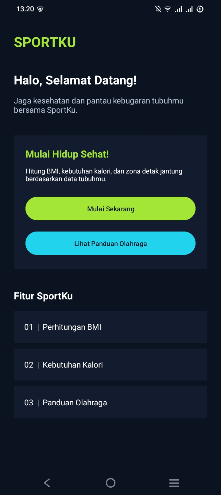
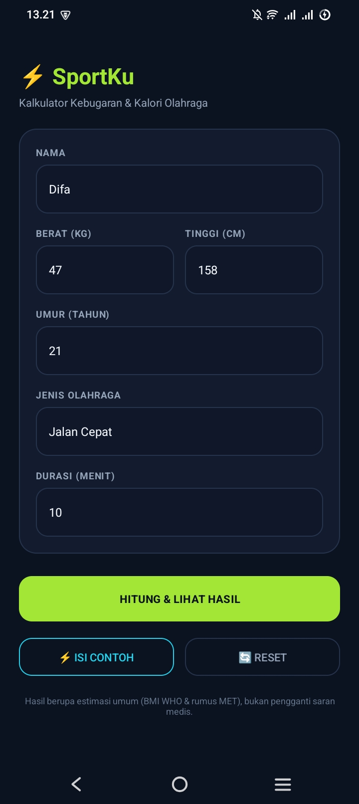
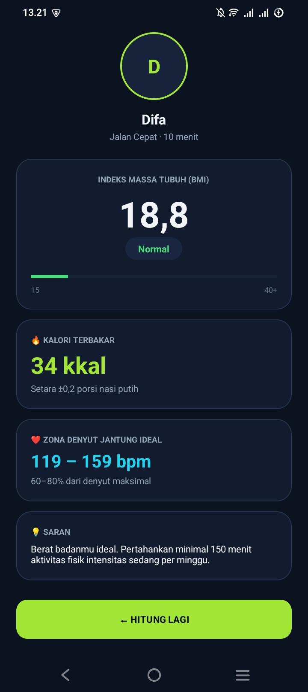
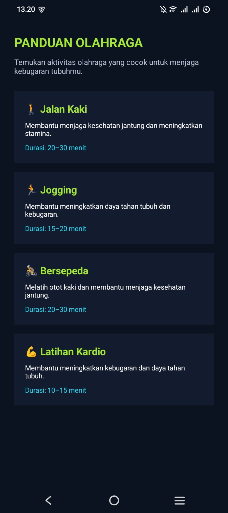

#  SportKu – Aplikasi Pemantau Kebugaran Tubuh

**SportKu** adalah aplikasi Android yang membantu pengguna mengenal kondisi kebugaran tubuh melalui perhitungan BMI, kebutuhan kalori, dan zona detak jantung. Selain itu, tersedia panduan olahraga sederhana untuk membantu pengguna memulai gaya hidup yang lebih sehat dan aktif.

Aplikasi ini dikembangkan menggunakan Kotlin dan XML Layout di Android Studio sebagai project tugas mata kuliah **Pemrograman Mobile**.

##  Fitur & Tampilan Aplikasi

### 1. Beranda (HomeActivity)



Halaman utama SportKu menampilkan sambutan kepada pengguna, pengenalan aplikasi, dan beberapa fitur yang tersedia. Terdapat tombol **Mulai Sekarang** untuk menuju halaman input data serta tombol **Lihat Panduan Olahraga** untuk membuka informasi aktivitas olahraga.

### 2. Input Data Pengguna (MainActivity)



Pada halaman ini, pengguna dapat memasukkan informasi berupa nama, berat badan, tinggi badan, usia, jenis aktivitas olahraga, dan durasi olahraga. Data tersebut akan diproses untuk menghasilkan informasi kebugaran tubuh.

### 3. Hasil Perhitungan (HasilActivity)



Halaman hasil menampilkan informasi berdasarkan data yang telah dimasukkan pengguna, meliputi:
- Nilai BMI dan kategori indeks massa tubuh.
- Perkiraan kebutuhan kalori.
- Zona detak jantung.
- Rekomendasi untuk mendukung aktivitas dan kebugaran tubuh.

### 4. Panduan Olahraga (TipsActivity)



Halaman ini menyediakan informasi beberapa aktivitas olahraga, seperti jalan kaki, jogging, bersepeda, dan latihan kardio. Setiap aktivitas dilengkapi deskripsi singkat serta rekomendasi durasi agar pengguna memiliki referensi dalam memilih olahraga.

##  Teknologi & Komponen

- **Bahasa Pemrograman:** Kotlin.
- **IDE:** Android Studio.
- **Layout:** XML.
- **Platform:** Android.
- **Komponen:** Activity, Intent, ViewBinding, EditText, TextView, Button, Spinner, dan ScrollView.
- **Konsep:** Activity Lifecycle, navigasi antarhalaman, pengolahan input, dan validasi data.

##  Cara Menjalankan Aplikasi

1. Install Android Studio dan pastikan Android SDK serta JDK sudah tersedia.
2. Clone repository:

   ```bash
   git clone https://github.com/USERNAME-GITHUB/SportKu.git
   ```

3. Buka folder project SportKu melalui Android Studio.
4. Tunggu proses Gradle Sync hingga selesai.
5. Pilih emulator atau perangkat Android.
6. Klik tombol **Run (▶)** untuk menjalankan aplikasi.

##  Demo Aplikasi

Video demonstrasi SportKu berdurasi 1–2 menit yang memperlihatkan:
- Tampilan awal aplikasi.
- Proses pengisian data pengguna.
- Proses perhitungan kebugaran.
- Hasil perhitungan BMI dan informasi lainnya.
- Navigasi menuju panduan olahraga.
- Contoh pengujian input tidak valid.

**Link Video Demo:** Tambahkan tautan video di sini.

---

**SportKu – Start Healthy, Stay Active! 💚**

*Dikembangkan untuk memenuhi tugas mata kuliah Pemrograman Mobile.*
